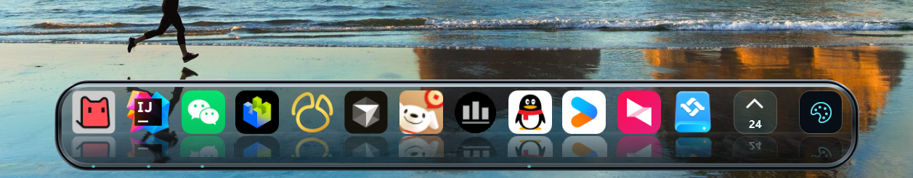

# 栖 Dock

让常用应用停靠在桌面上。支持可调主题、图标倒影、音乐律动和运行窗口切换的 Windows 桌面 Dock。

镜面金属主题实机效果：连续圆角包边、渐隐图标倒影、运行标记，以及向上展开的更多应用入口。

## 下载

**[进入最新版本下载页](https://github.com/wuyaode/qi-dock-downloads/releases/latest)**

| 文件 | 适合谁 | 使用方法 |
| --- | --- | --- |
| [QiDock-Setup-1.0.0.exe](https://github.com/wuyaode/qi-dock-downloads/releases/download/v1.0.0/QiDock-Setup-1.0.0.exe) | 希望通过向导安装 | 双击后按中文向导操作，可创建桌面快捷方式 |
| [QiDock-Portable-1.0.0.zip](https://github.com/wuyaode/qi-dock-downloads/releases/download/v1.0.0/QiDock-Portable-1.0.0.zip) | 希望免安装使用 | 完整解压，再运行 `QiDock/栖Dock.exe` |

下载上表中的安装程序或免安装 ZIP 即可。GitHub 自动生成的“Source code”压缩包是本下载页的文件，不包含可运行程序。

支持 **Windows 10 / Windows 11**，需要 **.NET Framework 4.8 或兼容的 4.8.1**。如果电脑缺少运行环境，可使用[微软官方下载](https://dotnet.microsoft.com/zh-cn/download/dotnet-framework/net48)。当前安装包尚未进行代码签名。

## 可以做什么

- **十套主题，三种材质**：经典简洁、梦幻雾透和镜面金属；颜色、透明度、圆角和光带均可调整。
- **统一悬停放大与倒影**：所有图标使用一致的放大倍率；倒影跟随图标变化，可单独开关和调整强度。
- **拖入与排序**：支持应用、快捷方式、文件夹和回收站等桌面项目，可右键管理或换图标。
- **更多应用面板**：向上展开完整列表，支持滚动、搜索、分类和拖拽排序。
- **切换运行窗口**：显示应用的运行状态，点击切换窗口，再次点击可最小化。
- **音乐律动**：底部频谱与边缘光可单独使用，也可叠加。
- **桌面偏好**：支持开机自动运行、自动隐藏、置顶、屏幕选择与减少动态效果。

## 开始使用

1. 安装或完整解压后，启动栖 Dock。
2. 将这台电脑的应用或快捷方式拖进 Dock。
3. 点击最右侧调色板进入“主题与设置”，选择喜欢的主题。
4. 想使用截图效果，可在主题工坊选择“镜面金属”，再调整圆角、透明度和倒影强度。部分设置需要向下滚动查看。

首次运行使用默认入口，不包含作者电脑的应用列表或个人设置。主题的雾透效果通过透明叠色、纹理和高光绘制，不采集桌面画面；音乐律动在本机分析正在播放的系统音频，不保存录音。

## 更新、卸载与设置

更新前先从 Dock 菜单退出。安装版运行新版安装程序即可；免安装版替换程序和 `栖Dock.exe.config`。

个人配置位于程序旁的 `设置.json`，自定义图标位于 `图标` 文件夹。更新会保留这些内容。安装版默认放在当前用户的 `%LOCALAPPDATA%\Programs\QiDock`，可从 Windows“设置 → 应用”卸载；卸载也会保留个人配置与图标。

开机自动运行在“主题与设置 → 行为偏好”中开启。移动程序前先关闭该开关，从新位置打开后再重新开启。

## 反馈问题

[提交问题或建议](https://github.com/wuyaode/qi-dock-downloads/issues)。请附上 Windows 版本、栖 Dock 版本、操作步骤和相关截图。
